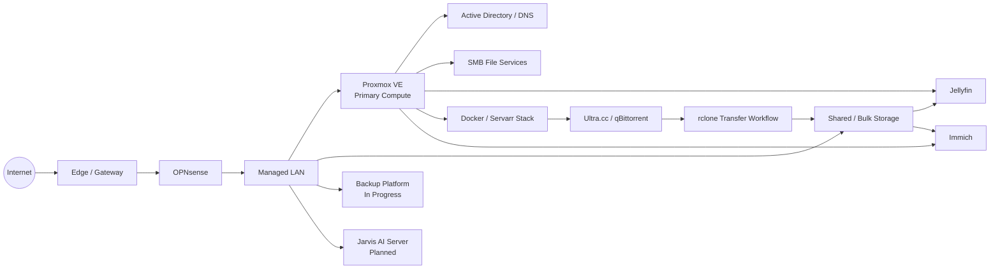
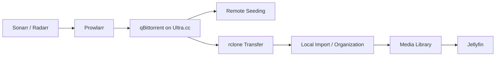

# GR2F Home Lab

A public, high-level view of the GamesR2Fun Home Lab: the hardware, platforms, services, automation, projects in progress, and the direction the lab is growing toward.

> **Privacy note:** This repository is intentionally sanitized. It does not publish private network addresses, credentials, internal access details, sensitive configuration, backup locations, or operational secrets. Detailed runbooks and production documentation are maintained separately in a private repository.

## What this lab is

This Home Lab started as a place to run core services and media workloads, but it has gradually grown into a broader environment for virtualization, storage, automation, backups, observability, self-hosting, and local AI.

The goal is not simply to run as many applications as possible. New services are generally added when they solve a real problem, improve reliability, reduce repetitive work, or provide a useful platform for experimenting with infrastructure and automation.

A major design goal is **rebuildability**: services should be understandable, documented, recoverable, and increasingly easy for both people and AI assistants to operate safely.

## Core hardware

### Primary virtualization server

The main lab server is a **Dell PowerEdge R730xd** running Proxmox VE.

Current high-level hardware includes:

- Dual Intel Xeon E5-2680 v4 processors
- Approximately 96 GB of memory
- SSD-backed storage for the host and virtual workloads
- Large ZFS bulk-storage pool for media and other data
- NVIDIA Tesla P4 used by Jellyfin for hardware-accelerated video processing

The server hosts most of the core virtual machines and containers used by the lab.

### Storage

Storage is separated by workload rather than treated as one large pool:

- **System storage** for the hypervisor
- **VM/container storage** for virtual workloads
- **Bulk storage** for media and larger datasets

ZFS is used for the primary local storage design, with redundancy appropriate to each tier.

### Local AI platform

A separate machine is being prepared as the foundation for **Jarvis**, the local-AI platform. The initial build is planned around a Ryzen 7 3700X and RTX 3070, with the design leaving room to expand GPU capability later if the workloads justify it.

## At a glance

| Area | Current state |
| --- | --- |
| Virtualization | Proxmox VE on a Dell PowerEdge R730xd |
| Storage | ZFS-backed SSD and bulk-data tiers |
| Identity | Windows Server Active Directory and DNS |
| File services | Debian-based SMB storage |
| Media | Jellyfin with NVIDIA hardware acceleration |
| Media automation | Sonarr, Radarr, Prowlarr, Recyclarr and supporting tools |
| Remote acquisition | Ultra.cc + qBittorrent + rclone workflow |
| Photo management | Immich |
| Container management | Docker + Portainer |
| Networking | OPNsense + managed switching + UniFi edge/network services |
| Backups | Backup redesign in progress, with Proxmox Backup Server planned for fuller deployment |
| Monitoring | Existing monitoring plus broader health/notification work in progress |
| Local AI | Dedicated Jarvis server being planned and prepared |
| Documentation | Private GitHub + Obsidian knowledge base with this sanitized public view |

## Architecture overview

This diagram is deliberately conceptual. Exact addressing, credentials, firewall rules, mount paths, access URLs, and other operational details are not published here.

## Core infrastructure

### Proxmox VE

Proxmox VE is the primary virtualization platform. Core services are separated into VMs and Linux containers instead of being installed directly on the hypervisor.

This makes it easier to isolate workloads, allocate resources, migrate services, back them up, and rebuild individual systems without disturbing everything else.

### OPNsense and managed networking

OPNsense provides the main firewall and routing layer for the lab. Managed switching and UniFi network services provide the rest of the network foundation.

The private documentation contains the actual topology and network configuration; this repository intentionally keeps networking at the architectural level.

### Active Directory and DNS

A Windows Server domain controller provides Active Directory, DNS, and related identity services for systems that benefit from centralized Windows authentication and name resolution.

### SMB file services

A Debian-based file server provides SMB access to shared storage. Keeping file-serving responsibilities separate from the hypervisor makes the storage easier to consume from Windows, Linux, applications, and media services.

## Media platform

### Jellyfin

Jellyfin is the primary media server. It uses an NVIDIA Tesla P4 for hardware-assisted transcoding so the CPU does not have to handle every video conversion workload in software.

The library includes a mixture of television, movies, anime, music, and older/archival media.

### Sonarr and Radarr

**Sonarr** manages television and episodic media while **Radarr** performs the same role for movies. They track wanted content, releases, quality targets, imports, naming, and library organization.

### Prowlarr

Prowlarr centralizes indexer management and distributes indexer configuration to the applications that need it.

### Recyclarr

Recyclarr is used to keep quality profiles and custom-format preferences consistent across the media automation stack.

### Remote acquisition and transfer

Downloads are handled remotely through **Ultra.cc** with **qBittorrent** rather than running the download client directly against the local media server.

Once content is ready, a controlled **rclone** workflow brings completed media into local storage for import and long-term use.

The workflow is intentionally separated into stages:

A separate lifecycle-management project is being developed to safely clean up remote torrents only after transfer, import, retention, and seeding requirements are proven satisfied.

## Photos and personal media

**Immich** is being used for self-hosted photo and video management. It provides a modern library experience with features such as timeline browsing, metadata handling, and face recognition while keeping the primary data under local control.

This part of the lab is still evolving as older photo/video collections are organized, deduplicated, and imported.

## Containers and service management

A dedicated Docker environment hosts much of the media automation stack and related applications.

**Portainer** provides a graphical interface for container management while Compose-style configuration keeps services reproducible and easier to document.

## Backup and recovery

Backup architecture is currently being redesigned.

A dedicated **Proxmox Backup Server** platform is part of the target design, but it will not be treated as production-ready until storage, schedules, retention, and restores are actually validated.

The broader goal is to reduce the number of overlapping backup tools while improving confidence that important systems can be restored when needed.

Historical virtual-machine backups are also being archived and cleaned up as the environment transitions away from older infrastructure.

## Monitoring and observability

Monitoring is being expanded beyond simple up/down checks.

The long-term view includes visibility into:

- Service health
- Host and VM availability
- Storage health and capacity
- Network performance
- Media streams
- Transfer activity
- Recent media additions
- Backup status
- GPU usage
- Infrastructure alerts and notifications

A consolidated dashboard is planned so the state of the lab can be understood without opening several separate interfaces.

## Jarvis / local AI

One of the larger upcoming projects is **Jarvis**, a dedicated local-AI platform.

The first phase is focused on establishing the hardware and software foundation. Longer term, Jarvis is intended to become more than a Home Lab chatbot.

Potential roles include:

- Home Lab monitoring and administration
- Reading logs and assisting with troubleshooting
- Running routine commands and workflows under controlled permissions
- Documentation and knowledge retrieval
- Smart-home assistance
- Workshop voice assistant
- Camera-assisted tool and object location
- Step-by-step building and repair guidance

The project is intentionally being built gradually so automation and permissions can be introduced safely instead of giving an AI unrestricted infrastructure access from day one.

## Documentation and AI-assisted operations

The private Home Lab documentation is maintained in an **Obsidian vault backed by GitHub**.

That documentation is designed to be useful to both humans and AI agents. It tracks current state, planned work, historical architecture, troubleshooting evidence, rebuild procedures, decisions, and verification gaps.

AI tools are increasingly used to help:

- Compare documentation against actual system state
- Review logs and configuration
- Maintain troubleshooting records
- Update diagrams and inventories
- Track roadmap work
- Prepare implementation plans

The detailed knowledge base remains private. This repository is a deliberately slower-moving, sanitized view of the same overall project.

## Current projects

### Backup redesign / PBS

Preparing storage and recovery strategy before Proxmox Backup Server is considered fully deployed.

### qBittorrent lifecycle management

Building safe torrent cleanup logic that can prove transfer/import/seeding conditions before any automatic deletion is allowed. Development is intentionally starting in report-only mode.

### Monitoring and notifications

Expanding health monitoring and creating a cleaner notification strategy for infrastructure events.

### Public Home Lab documentation

Building this repository into a useful technical overview while keeping operational details private.

## Planned services and improvements

- **Jarvis** — dedicated local AI and automation platform
- **Homarr** — unified Home Lab dashboard
- **Bazarr** — subtitle automation
- **Seerr** — media request management
- **Huntarr** — missing-content and quality automation
- **autobrr** — torrent announcement and automation tooling
- **Expanded monitoring** — storage, networking, transfers, streams, backups, GPU usage, and service health
- **Improved restore testing** — repeatable recovery validation rather than simply confirming backups exist

See the [public roadmap](roadmap/roadmap.md) for the current project-status view.

## Repository map

| Page | Purpose |
| --- | --- |
| [Architecture overview](architecture/overview.md) | High-level platform and data-flow design |
| [Services overview](services/services.md) | Current and planned service inventory |
| [Roadmap](roadmap/roadmap.md) | Public project status and future direction |
| [Publication safety checklist](PUBLICATION-CHECKLIST.md) | Checks performed before this repository is made public |

## What this repository intentionally excludes

This public view does **not** publish:

- private IP addresses or internal DNS records;
- usernames, passwords, API keys, tokens, private keys, cookies, or VPN credentials;
- detailed firewall rules or security policy;
- internal remote-access configuration;
- exact storage mount paths or sensitive backup locations;
- private logs, troubleshooting captures, or raw configuration containing identifiers;
- the detailed private Git history of the operational documentation.

## Update model

This repository is intentionally updated less frequently than the private operational documentation. It is meant to show the architecture, technology choices, completed projects, and future direction rather than act as a live operations manual.

Major completed projects and meaningful architecture changes are periodically summarized here after a privacy review.
