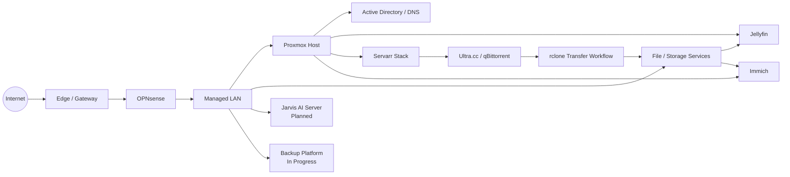

# GR2F Home Lab

A public, high-level view of the GamesR2Fun Home Lab: the platforms in use, the services currently running, projects in progress, and planned improvements.

> **Privacy note:** This repository is intentionally sanitized. It does not contain private network addresses, credentials, internal access details, sensitive configuration, backup locations, or operational secrets. The detailed operational documentation is maintained separately in a private repository.

## At a glance

The lab is built around virtualization, self-hosted media, storage, automation, backups, monitoring, and a growing local-AI platform.

| Area | Current state |
| --- | --- |
| Virtualization | Proxmox VE on a Dell PowerEdge R730xd |
| Storage | ZFS-backed SSD and bulk-media storage tiers |
| Identity | Windows Server Active Directory and DNS |
| File services | Debian-based SMB storage |
| Media | Jellyfin with NVIDIA hardware acceleration |
| Media automation | Sonarr, Radarr, Prowlarr, Recyclarr and related automation |
| Remote acquisition | Ultra.cc + qBittorrent + rclone workflow |
| Photo management | Immich |
| Networking | OPNsense + managed switching + UniFi edge/network services |
| Backups | Backup redesign in progress, with Proxmox Backup Server planned for fuller deployment |
| Local AI | Dedicated Jarvis/local-AI server planned and being prepared |

## Architecture overview

This diagram is deliberately conceptual. Exact addressing, credentials, firewall rules, mount paths, and other operational details are not published here.

## Current services

### Core infrastructure

- **Proxmox VE** — primary virtualization platform.
- **OPNsense** — routing and firewall platform.
- **Active Directory / DNS** — Windows-based identity and local name services.
- **SMB file services** — shared storage presented from Linux-based file services.
- **ZFS storage** — separate system, VM, and bulk-data storage tiers.

### Media and automation

- **Jellyfin** — primary media server with NVIDIA hardware transcoding.
- **Sonarr** — TV-series management and automation.
- **Radarr** — movie management and automation.
- **Prowlarr** — indexer management.
- **Recyclarr** — quality-profile and custom-format synchronization.
- **qBittorrent** — remote download client hosted on Ultra.cc.
- **rclone** — controlled transfer workflow from remote acquisition into local storage.
- **Immich** — photo and video management.

### Operations and tooling

- **Portainer** — Docker management.
- **Read-only Jellyfin troubleshooting integration** — scoped remote log access for diagnostics.
- **GitHub + Obsidian documentation workflow** — private source-of-truth documentation with automated and AI-assisted maintenance.

## In progress

- **Backup redesign / Proxmox Backup Server** — storage is being prepared before the backup platform is fully built out and validated.
- **qBittorrent lifecycle management** — safe cleanup and seeding-state automation is being developed cautiously, with report-only validation before any destructive automation is enabled.
- **Monitoring and health visibility** — expanding service, infrastructure, and notification coverage.
- **Public Home Lab documentation** — this repository is being built as a slower-moving, sanitized snapshot of the private operational documentation.

## Planned

- **Jarvis local-AI server** — dedicated GPU-backed local AI system intended to grow beyond Home Lab administration into workshop and smart-home assistance.
- **Homarr dashboard** — consolidated lab status and service overview.
- **Bazarr** — subtitle automation.
- **Seerr** — media-request management.
- **Huntarr** — media-quality and missing-content automation.
- **autobrr** — torrent announcement and automation tooling.
- **Expanded monitoring** — deeper visibility into services, storage, streaming, transfers, networking, and system health.

See [Roadmap](roadmap/roadmap.md) for the public project-status view.

## Public documentation

- [Architecture overview](architecture/overview.md)
- [Services overview](services/services.md)
- [Roadmap](roadmap/roadmap.md)
- [Publication safety checklist](PUBLICATION-CHECKLIST.md)

## What this repository intentionally excludes

This public view does **not** publish:

- private IP addresses or internal DNS records;
- usernames, passwords, API keys, tokens, private keys, cookies, or VPN credentials;
- detailed firewall rules or security policy;
- internal remote-access configuration;
- exact storage mount paths or sensitive backup locations;
- private logs, troubleshooting captures, or raw configuration containing identifiers;
- the detailed private Git history of the operational documentation.

## Update model

This repository is intentionally updated less frequently than the private operational documentation. It is meant to show the overall architecture and project direction rather than act as a live runbook.

Major completed projects and meaningful architecture changes are periodically summarized here after a privacy review.
