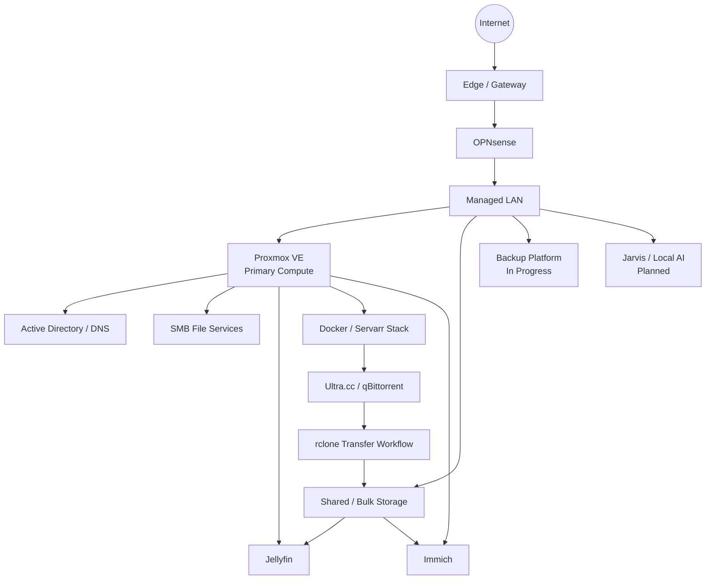
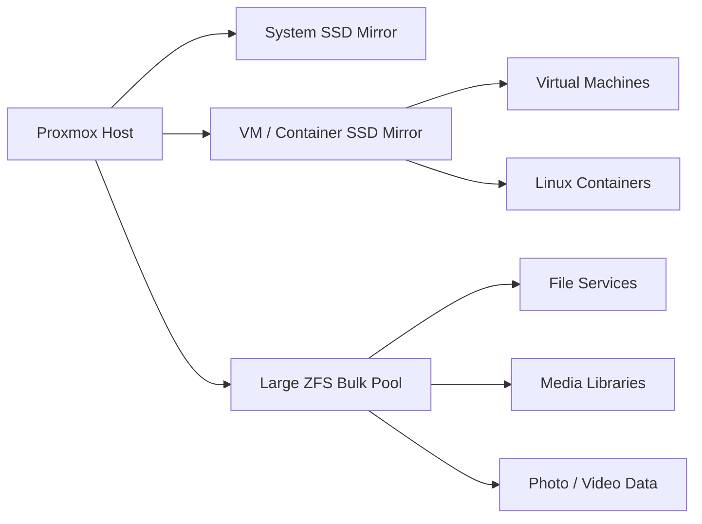
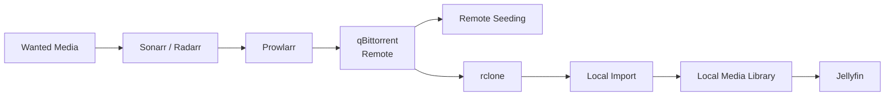

# Architecture Overview

This page describes the Home Lab at a conceptual level. It intentionally omits internal addressing, access paths, credentials, firewall rules, and other operational details.

## Platform layout

## Compute model

The lab is centered on a Dell PowerEdge R730xd running Proxmox VE. Most services run as VMs or containers rather than directly on the hypervisor.

This separation provides several advantages:

- Workloads can be restarted, rebuilt, or migrated independently.
- Resource allocation can be tuned per service.
- Linux containers are used where lightweight isolation makes sense.
- Full VMs are used where a separate kernel or operating system boundary is useful.
- Backups and restore testing can happen at the workload level rather than treating the host as one monolithic server.

The goal is to keep the hypervisor focused on compute, storage ownership, and virtualization rather than turning it into an application server.

## Storage model

Storage is divided by purpose:

Separating storage tiers helps keep random VM I/O away from large sequential media workloads and makes the role of each pool easier to understand and protect.

The public repository does not expose dataset names, mount points, share paths, or backup destinations.

## Media architecture

The media pipeline intentionally separates management, acquisition, transfer, storage, and playback.

This keeps download activity away from the primary media server while still allowing completed content to flow into local storage in a controlled way.

A separate lifecycle-management project is being developed to determine when remote downloads are truly safe to remove. Cleanup will only be considered trustworthy when transfer, import, local retention, and seeding conditions can be verified.

## Identity and file services

Windows Server Active Directory and DNS provide centralized identity and name services for the parts of the lab that benefit from them.

Shared storage is exposed through a Debian-based SMB service rather than being served directly from the hypervisor. This creates a cleaner separation between storage ownership and client-facing file access.

## Media playback acceleration

Jellyfin uses an NVIDIA Tesla P4 for hardware-accelerated video processing. This offloads supported decode/encode work from the server CPUs and makes simultaneous playback and transcoding workloads more practical.

## Photo and video management

Immich provides a self-hosted photo/video library. It sits on top of locally controlled storage while providing modern features such as timeline browsing, metadata processing, and face recognition.

The photo-management portion of the lab is still evolving as older collections are sorted, deduplicated, and imported.

## Backup architecture direction

The backup design is intentionally being rebuilt rather than simply layering another tool on top of the existing environment.

A dedicated Proxmox Backup Server platform is part of the target design. The project will only be considered complete after the following are validated:

- Storage is available and appropriate for backup workloads.
- Backup jobs run successfully.
- Retention behavior is understood.
- Important workloads can actually be restored.
- Recovery procedures are documented and repeatable.

The design goal is fewer overlapping backup systems and greater confidence in recovery.

## Monitoring direction

The lab currently has basic monitoring capabilities, but the target is a broader health view covering compute, storage, media, networking, transfers, backups, and GPU usage.

A future consolidated dashboard is expected to combine selected information such as:

- Host/service availability
- Storage health and capacity
- Network throughput
- Active media streams
- Transfer status
- Recent additions
- Backup state
- GPU usage
- Alerts and notifications

## Local AI direction

A dedicated GPU-backed AI server is planned as the foundation for Jarvis.

The first phase is infrastructure-focused: establish the compute platform, local models, and controlled access to Home Lab information.

Longer-term goals include:

- Log analysis and troubleshooting assistance
- Documentation retrieval and updates
- Controlled command execution
- Smart-home interaction
- Workshop voice assistance
- Camera-assisted object/tool location
- Step-by-step build and repair guidance

The architecture is intentionally moving toward scoped permissions and tool-specific access rather than unrestricted administrative control.

## Documentation architecture

The detailed Home Lab knowledge base is maintained privately in Obsidian and GitHub.

The documentation is treated as part of the infrastructure itself. It records current state, planned work, historical changes, troubleshooting evidence, architecture decisions, rebuild procedures, and verification gaps.

This public repository is a manually reviewed derivative intended for sharing. It is not automatically synchronized from the private knowledge base.

## Design principles

### Virtualization first

Keep application workloads in VMs or containers and avoid unnecessary services on the hypervisor.

### Separate responsibilities

Compute, storage, identity, file serving, media, downloads, and backup are treated as distinct roles even when some share the same physical hardware.

### Validate destructive automation

Automation involving deletion, cleanup, permissions, or infrastructure changes should begin in read-only or report-only form and only become destructive after its safety assumptions are proven.

### Prefer rebuildable systems

Configuration, dependencies, decisions, and recovery procedures should be documented well enough that a failed service can be recreated rather than treated as irreplaceable.

### Grow deliberately

New services are added because they solve a real problem or enable a useful capability, not simply to increase the application count.

## Privacy boundary

The private operational documentation contains the details needed to run and troubleshoot the environment. This public repository intentionally stays at the architecture-and-project level so it can be safely shared.
