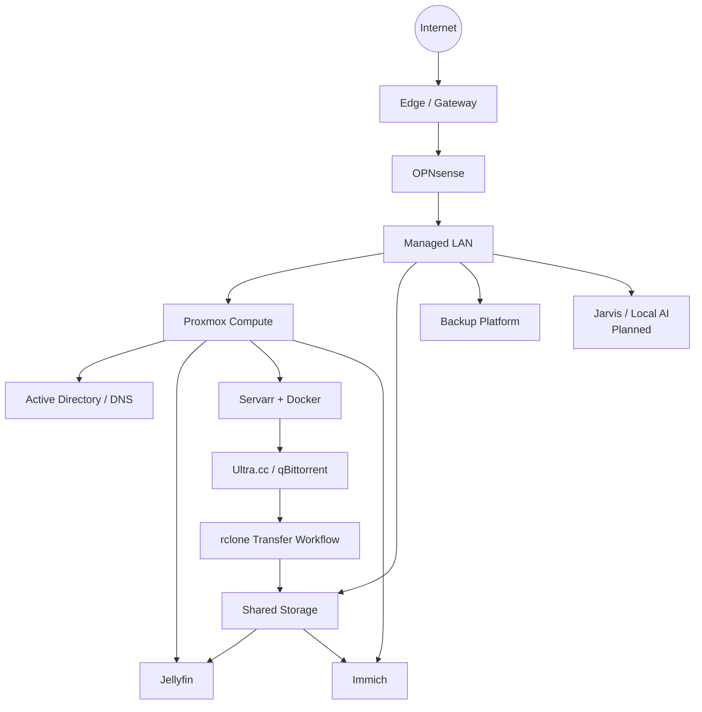

# Architecture Overview

This page describes the Home Lab at a conceptual level. It intentionally omits internal addressing, access paths, credentials, firewall rules, and other operational details.

## Platform layout

## Design themes

### Virtualization first

Most infrastructure runs as VMs or containers on Proxmox. This keeps workloads isolated while making rebuilds, migrations, backups, and resource allocation easier to manage.

### Storage separated by purpose

System storage, VM/container storage, and bulk media are separated into different ZFS-backed tiers. The public documentation intentionally does not publish internal mount paths or dataset details.

### Media pipeline

Media automation is separated into discovery/management, remote acquisition, transfer, and local serving. Sonarr/Radarr/Prowlarr coordinate content, Ultra.cc hosts qBittorrent, rclone handles controlled transfers, local storage retains the library, and Jellyfin serves the final media.

### Local AI direction

A dedicated GPU-backed AI server is planned as the foundation for Jarvis. The long-term goal is broader local assistance across Home Lab operations, workshop use, and smart-home interactions rather than just a single chatbot workload.

### Backup direction

A dedicated backup platform based around Proxmox Backup Server is being prepared. The design is being staged carefully so storage and recovery behavior are validated before it is considered production-ready.

## Privacy boundary

The private operational documentation contains the details needed to run and troubleshoot the environment. This public repository intentionally stays at the architecture-and-project level so it can be safely shared.
