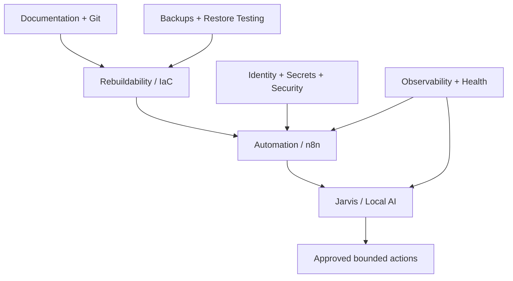

# Public Roadmap

This roadmap is intentionally higher-level and slower-moving than the private operational backlog. It shows the direction of the lab without exposing private addressing, credentials, access paths, detailed firewall policy, exact storage paths, or raw troubleshooting evidence.

The public roadmap is grouped by **Now / Next / Later / Evaluation / Done**. Items marked as evaluation candidates are ideas under consideration, not selected deployments.

## Now

### Backup redesign / Proxmox Backup Server

The lab is moving toward a simpler backup architecture centered on Proxmox Backup Server.

Current focus:

- Free and prepare appropriate backup storage
- Reduce dependence on overlapping legacy backup methods
- Define retention and recovery expectations
- Build restore testing into the design
- Protect newer workloads, including the photo-management stack

The project will not be considered complete just because backup jobs run. A real restore test is part of the finish line.

### qBittorrent lifecycle management

The remote acquisition pipeline can transfer media successfully, but automatic remote cleanup requires stronger proof before destructive actions are enabled.

Current focus:

- Verify the full payload was transferred successfully
- Confirm Arr import completed
- Confirm the expected local library files still exist
- Respect the torrent's existing seeding requirements
- Detect shared/cross-seeded files before removal
- Fail closed when any required evidence is missing

The cleanup design is intentionally progressing through read-only/report-only validation before automatic deletion is considered.

### Monitoring, health checks, and notifications

The monitoring strategy is expanding beyond simple uptime checks into layered observability.

Target responsibilities include:

- **Uptime Kuma** for service reachability
- **Healthchecks** for scheduled-job/dead-man monitoring
- **Grafana / Prometheus / Loki / Alloy** for metrics, logs, and troubleshooting telemetry
- **Scrutiny** for disk-health history where hardware support is suitable
- **ntfy** for a common self-hosted notification layer
- **Wazuh** for security/host telemetry if selected after evaluation

The goal is useful, deduplicated alerts rather than every service sending its own independent notification storm.

### Photo/video migration and organization

Immich is deployed and the migration of existing photo/video collections is underway.

Current work includes:

- Deduplication and import review
- Preserving useful metadata and sidecars
- Reconciling import-count differences
- Migrating additional source collections cautiously
- Keeping original source data until backup and restore protection is proven

### Public Home Lab documentation

This repository is being developed into a slower-moving, shareable snapshot of the Home Lab. It stays separate from the private source-of-truth documentation so every public update can receive a privacy review first.

## Next

### Jarvis local-AI server

Build the first dedicated GPU-backed local-AI host.

Planned initial hardware:

| Component | Planned |
| --- | --- |
| CPU | AMD Ryzen 7 3700X |
| RAM | 32 GB DDR4 |
| GPU | RTX 3070 8 GB |
| Role | 24/7 local AI / automation platform |

Initial software/platform goals:

- Local model serving with Ollama or an equivalent runtime
- Open WebUI or similar local interface
- Local access to synchronized Home Lab documentation
- A derived RAG/vector index such as Qdrant
- Read-only infrastructure integrations first
- Narrow, approved automation capabilities later

Performance with the first RTX 3070 will be measured before deciding whether additional GPU hardware is worthwhile.

### Automation foundation

Several shared platform components are high-interest candidates because they would become building blocks for many later projects:

| Candidate | Intended role |
| --- | --- |
| **n8n** | Deterministic workflow/orchestration layer for APIs, alerts, scripts, and approved Jarvis actions |
| **Infisical** | Machine/API secret management and future brokered automation credentials |
| **LiteLLM** | Common gateway in front of local/cloud AI models |
| **Healthchecks** | Monitoring for backups, transfers, maintenance, and other scheduled jobs |
| **ntfy** | Common push-notification layer |

These are planned/evaluation items, not currently deployed services.

### Rebuildability / Infrastructure as Code

Move the lab toward reproducible infrastructure rather than hand-built systems.

Planned toolchain candidates include:

- Proxmox automated installation
- Packer / Cloud-Init templates
- OpenTofu for guest provisioning
- Ansible for repeatable host/service configuration
- Semaphore UI as an optional controlled job runner
- Docker Compose definitions stored in Git
- Renovate for controlled update proposals

Target outcome: a normal service rebuild becomes **provision → configure → restore state/data → validate**, instead of reconstructing settings from memory.

### Safer maintenance automation

Develop a deterministic maintenance workflow that can eventually:

1. Discover available updates
2. Run pre-flight health checks
3. Confirm a durable recovery point exists
4. Apply an approved update workflow
5. Reboot/restart only when required
6. Validate the workload afterward
7. Roll back through a tested recovery path when safe
8. Produce a maintenance report

Critical infrastructure will remain an explicit-approval class rather than being blindly automated.

### Security and identity improvements

Planned security direction includes evaluating:

- **Authentik** for centralized SSO/MFA on compatible internal services
- **Caddy or Traefik** as a standardized HTTPS/reverse-proxy layer
- **Wazuh** for centralized security/host telemetry
- **Trivy** for vulnerability/configuration/secret scanning
- **Infisical** for machine/API secrets
- Network segmentation as the automation/AI trust boundary grows

The design principle is read-only by default, least privilege, dedicated service identities, auditable workflows, and no generic root/admin shell exposed to Jarvis.

### Media automation expansion

Planned or evaluation items include:

- **Bazarr** — subtitle automation
- **Seerr** — media request management
- **Huntarr** — missing-content / quality automation
- **Tdarr** — media processing/transcoding evaluation
- **Cleanuperr** — media/download cleanup evaluation
- **autobrr** — torrent announcement automation
- **FileFlows** — workflow/media-processing evaluation

New applications should fill a real gap rather than simply increasing service count.

### Planned test/specialized guests

- **Jellyfin-Test** — separate environment for upgrades, plugins, and configuration experiments before production rollout
- **Servarr-Anime** — separate Anime-focused Arr stack so Anime-specific behavior can evolve independently of the main stack

### Homarr dashboard

Build a human-friendly operations portal that can surface selected information such as:

- Service status
- Storage capacity/health
- Jellyfin activity
- Transfer progress
- Recent additions
- Network telemetry
- Host resource usage
- VPN state

## Later

### Jarvis voice and workshop assistant

The long-term Jarvis goal extends beyond Home Lab administration.

Potential capabilities include:

- Wake-word operation such as **“Hey Jarvis”**
- Far-field voice pickup designed for a loud workshop
- Local speech-to-text and text-to-speech where practical
- Voice-first Home Lab status and troubleshooting
- Camera/vision support for locating visible tools and items
- Context-aware build/repair guidance while working
- Narrow integration with the existing smart-home environment through supported APIs

Cameras, microphones, and automation materially expand the privacy/security boundary and will be designed accordingly.

### Read-only observability gateway

Expand the existing narrow AI troubleshooting model into a broader read-only observability layer. The desired architecture favors centralized telemetry and constrained API/query adapters instead of unrestricted shell access.

Potential read-only sources include Proxmox/PBS, Jellyfin, Immich, Uptime Kuma, monitoring platforms, storage health, backups, and structured infrastructure inventory.

### Controlled Jarvis actions

Future write-capable Jarvis actions should run through bounded capabilities rather than a general privileged shell.

Examples might eventually include:

- Start an approved backup
- Run an approved Ansible role
- Provision a bounded VM/LXC from an approved template
- Deploy an approved Compose stack
- Restart a specific service
- Run the approved maintenance pipeline

High-risk actions such as data deletion, storage changes, firewall/security changes, and broad infrastructure changes remain human-approved.

### Independent AI change review

A future safety layer is planned for Jarvis-initiated changes: create one immutable proposal, have it reviewed independently by two model providers, then pass deterministic policy checks and any required human approval before a constrained executor can act.

AI agreement would be an additional safety layer, not the authority granting access.

### Compute resilience / second Proxmox node

Evaluate adding a second compatible Proxmox compute node for maintenance flexibility and improved availability.

Potential supporting pieces include:

- Two-node Proxmox cluster with an external QDevice
- ZFS replication of selected critical guests
- Better planned-maintenance workflows
- Tested failover behavior for workloads that genuinely need it

Backup/restore and reproducible deployment come before clustering complexity.

### Supporting resilience services

Potential later additions include:

- NUT or equivalent UPS monitoring/shutdown coordination
- NetBox for structured machine-readable inventory/IPAM
- A local container registry where useful
- PXE/netboot after automated installation workflows are proven
- Regular disaster-recovery drills

### User-facing self-hosted services

Evaluation candidates that may be useful later:

| Candidate | Possible role |
| --- | --- |
| **Paperless-ngx** | Searchable archive for manuals, receipts, warranties, invoices, and other documents |
| **Audiobookshelf** | Dedicated audiobook/podcast library |
| **Linkwarden** | Bookmark/read-later archive and preserved technical references |
| **Vaultwarden** | Self-hosted password manager for human credentials |
| **Forgejo** | Optional local Git forge/mirror for local availability |

These are candidates, not committed deployments.

## Evaluation / deliberately deferred

Some technologies are interesting but are not currently justified by the size or architecture of the lab.

### Kubernetes / K3s

Revisit only when there is a genuine requirement for multi-node application scheduling, replicas, automated rescheduling, or a specific learning objective that justifies the added operational layer.

### Ceph

Revisit only when a larger multi-node Proxmox environment, balanced storage, sufficient resources, and appropriate high-speed storage networking exist. It is not currently the preferred answer for the lab.

### CrowdSec

Potential future edge/application abuse-detection layer if public exposure grows enough to justify another security control alongside the firewall/reverse-proxy stack.

## Done highlights

### Proxmox migration

Moved the primary Home Lab onto Proxmox VE and established a VM/container-first architecture.

### ZFS storage redesign

Built separate ZFS-backed storage tiers for the hypervisor, VM/container workloads, and bulk media/data.

### Jellyfin production platform

Deployed Jellyfin with NVIDIA hardware acceleration as the primary media server.

### Media automation stack

Built the Sonarr/Radarr/Prowlarr/Recyclarr automation platform.

### Remote acquisition pipeline

Implemented the Ultra.cc + qBittorrent + rclone workflow for remote acquisition, seeding, verified transfer, and local import.

### Immich platform

Deployed a dedicated Docker-based Immich environment and started migrating existing photo/video libraries into it.

### GitHub + Obsidian documentation platform

Migrated Home Lab operational documentation into a private GitHub-backed Obsidian knowledge base designed for human and AI-assisted maintenance.

### Read-only AI troubleshooting

Added narrow, read-only Jellyfin troubleshooting access as the first proven model for AI-assisted diagnostics without unrestricted server access.

### Dad-Lab environment

Created a separated virtualization area for family lab workloads.

## Roadmap philosophy

The longer-term direction is less about collecting applications and more about building reusable platform layers:

Recurring rules:

- Prefer maintainable/vendor-supported solutions where practical.
- Build shared platform layers instead of many fragile one-off integrations.
- Validate restores and rebuilds instead of assuming they work.
- Keep secrets out of Git and AI context.
- Start AI/automation integrations read-only.
- Use deterministic workflows for privileged actions.
- Keep destructive/high-risk changes behind explicit approval.
- Add complexity only when it solves a real problem.

## Notes

Items appear here only when they are appropriate to disclose publicly. Exact addresses, credentials, internal URLs, detailed security configuration, private storage paths, access-control details, and raw troubleshooting evidence remain in the private operational documentation.
